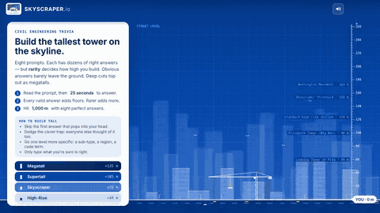

# Skyscraper.io

A civil-engineering trivia game by the ACI TIP Quezon City Student Chapter. Answer **8 prompts** in **25 seconds** each. Every valid answer adds floors to your tower, and **rarer answers build higher**. Eight perfect answers top out at **1,000 m**.

The scoring is inspired by daily "rarity" trivia games: correctness only qualifies an answer, and rarity decides how much it scores.

## Rarity tiers

| Tier | Height | Meaning |
| --- | ---: | --- |
| Low-Rise | +15 m | The answer almost everyone blurts out |
| Vanity Height *(trap)* | +20 m | The "clever" answer everyone reaches for |
| High-Rise | +40 m | Past the first few obvious picks |
| Skyscraper | +75 m | Genuinely uncommon, still recognisable |
| Supertall | +105 m | A true deep cut |
| Megatall | +125 m | The designated gem of the prompt |

| Run | Height | Milestone cleared |
| --- | ---: | --- |
| 8 × Low-Rise | 120 m | Standard high-rise skyline |
| 8 × Vanity Height | 160 m | Skyscraper threshold (150 m) |
| 8 × High-Rise | 320 m | Supertall threshold (300 m) and Chrysler Building |
| 8 × Skyscraper | 600 m | Megatall threshold (600 m) |
| 8 × Supertall | 840 m | Burj Khalifa (828 m) |
| 8 × Megatall | 1,000 m | Jeddah Tower target (1 km) |

Each visit draws a fresh random set of 8 prompts. Prompts you have seen recently are held back, and the draw mixes categories.



## How a prompt plays

1. **Read it.** The prompt appears with a 3-second countdown before the input and the 25-second timer show up (Enter skips it).
2. **Answer.** Your answer becomes a load on the crane hook and is **hoisted up past the tier lines**. The rarer the answer, the longer the ride: 0.6 s for a miss, 4.6 s for a gem. A Vanity (trap) answer sags back, and a miss drops off the hook.
3. **Full-screen reveal.** Every answer gets one, and the intensity climbs with the tier: flash, shake, sparks, rings and rays, then gold confetti, a GEM badge and a fanfare for a Megatall. The reveal shows the matched answer, the height gained and a one-line fact.
4. **Build-up.** Floors slam onto the tower one at a time with dust, welding sparks and clanks, and the crane climbs after big gains. Altitude zones (street level, above the rooftops, skyline, cloud base, above the clouds…) and landmark lines appear as you rise.

## How it looks

- **While building:** a flat 2D front elevation of the tower on a cobalt blueprint grid: glass curtain wall with white mullions, open frame and scaffolding at the top, a concrete core and an external tower crane. A ruler on the right shows the height with a YOU marker and ghost lines for real landmarks.
- **Sound:** every cue is synthesised in the browser with WebAudio (no audio files). The speaker button at the top right mutes it, and the setting is remembered.
- **When it tops out:** the page turns white over a faint cobalt blueprint grid. The crane leaves, and the crown and spire complete. The tower slides to the right, a rotating 3D structural CAD model appears on the left (drag to spin), and structural plan sheets sit faintly in the background. The summary in the middle shows your eight answers and every milestone you cleared.

The tower is a **bundled tube**: a 3 × 3 grid of 24 m cells. Each outer cell tops out at its own height (150 m to 880 m), so taller towers step back like real megatalls. The CAD model shows belt trusses at each of those transfer levels.

## Run locally

No build step, no dependencies. Open `index.html` in a browser, or serve the folder:

```bash
python3 -m http.server 8000
```

## Deploy on GitHub Pages

1. Push this folder to a GitHub repository.
2. Go to **Settings → Pages → Build and deployment**.
3. Set the source to **Deploy from a branch**, then choose `main` and `/ (root)`.
4. The site goes live at `https://<user>.github.io/<repo>/`.

## Editing the dataset

All prompts live in [`data/questions.js`](data/questions.js):

```js
{
  id: "truss-types",                 // unique
  category: "Structures",            // shown as a chip
  prompt: "Name a named type of truss.",
  strip: ["truss"],                  // filler words ignored when matching
  tiers: {
    lowrise:    ["Pratt", "Howe", "Warren"],
    vanity:     ["Vierendeel"],
    highrise:   ["King post|Kingpost", "Fink", "..."],
    skyscraper: ["Pennsylvania|Petit", "..."],
    supertall:  ["Burr|Burr arch", "..."],
    megatall:   ["Bollman"]          // the gem
  }
}
```

- Separate aliases with `|`. The first alias is what players see.
- Matching ignores case, accents, punctuation, spacing, "the", simple plurals and the prompt's `strip` words. It also tolerates 1–3 typos, depending on the answer's length.
- Answers that aren't in the bank score 0 m ("Not on the blueprints").

Check the dataset after editing:

```bash
node tools/check-dataset.js
```

It reports duplicate keys and answers that could be confused through typo tolerance.

### Optional fields

```js
facts:  { "Lenticular": "One-line fact shown in the reveal." },   // keyed by display name; every gem must have one
source: "NSCP 2015 §402.3"                                          // citation for reviewers; not shown in the UI
```

### Long-tail answers: `data/expansions.js`

Open-ended prompts such as "Name a real bridge" or "Name a real dam" have hundreds of valid answers. The long tail lives in [`data/expansions.js`](data/expansions.js), keyed by prompt id, and is merged in at load time. Anything that duplicates a curated answer is skipped, so tiers in `questions.js` always win. Expansions only add High-Rise, Skyscraper and Supertall answers.

**Sources:** the prompts were written for this game. The roof, wall, crane and materials-test prompts draw on the headword families of *A Dictionary of Construction, Surveying and Civil Engineering* (Gorse, Johnston & Pritchard, Oxford, 2nd ed.). The 15 `NSCP 2015` prompts cite the National Structural Code of the Philippines section each answer comes from. Philippine entries are tiered for a Filipino student audience, so Angat Dam and San Juanico Bridge are Low-Rise.

## Customising

- **Chapter logo:** the header shows `assets/aci-chapter-logo.png` (the ACI TIP Quezon City Student Chapter logo, cropped from the transparent original). Replace the file to change it.
- **Tiers, milestones, round size, timer:** edit [`js/config.js`](js/config.js).
- **Effect intensity:** `FX` in `js/config.js` sets, per tier, the hoist time, the reveal scrim, particle count and kind, shake and flash.
- **Altitude zones:** `ZONES` in `js/config.js`.

## Files

```
index.html            page shell
css/style.css         cobalt & white UI
js/config.js          tiers, milestones, tower geometry
js/matcher.js         answer matching (shared with the checker)
js/sfx.js             synthesised sound effects + mute
js/fx.js              particles, flashes, shake, the hoist sequence
js/flat.js            flat 2D gameplay renderer (front elevation)
js/tower.js           isometric tower (end screen only)
js/cad.js             3D structural model + plan sheets
js/game.js            game flow
data/questions.js     prompt dataset (curated tiers, facts, sources)
data/expansions.js    long-tail answers for open-ended prompts
tools/check-dataset.js
```
